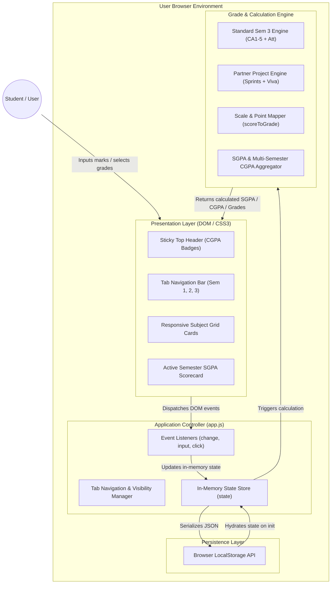
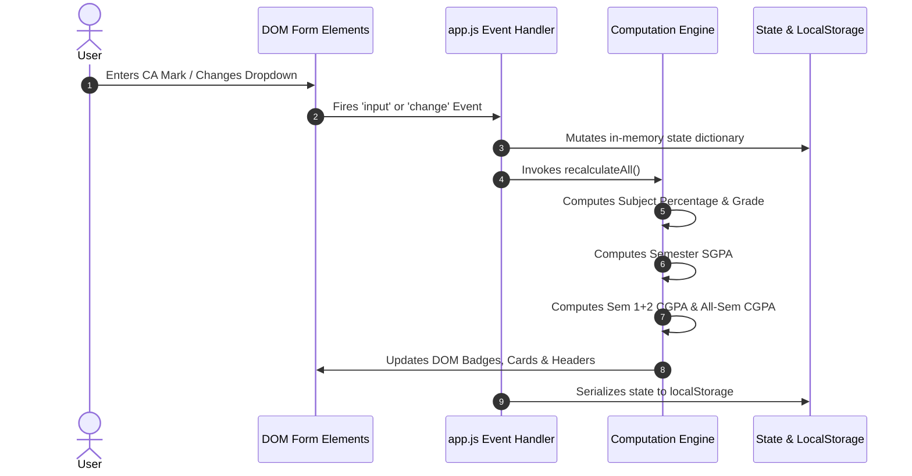

# High-Level Design (HLD)

**System Name:** SGPA & CGPA Academic Calculator  
**Architecture Pattern:** Client-Side Single Page Application (Jamstack / Zero-Backend Architecture)  
**Target Environment:** Modern Web Browsers (ES6+, HTML5, CSS3)  
**Document Version:** 1.0.0  

---

## 1. System Overview & Architecture Context

The SGPA & CGPA Calculator is built as a self-contained, client-side web application. It eliminates the need for server-side processing, databases, or cloud infrastructure by executing all mathematical grading formulas, state mutations, and persistence directly inside the client's browser environment.

### 1.1 Architecture Diagram

---

## 2. Component Decomposition

### 2.1 UI / Presentation Layer
- **`index.html`**: Defines semantic DOM layout containing the sticky header, dynamic CGPA score badges, ARIA tab navigation bar, current semester card, and responsive content viewports for each semester.
- **`styles.css`**: Implements a full-width responsive green-and-white theme using CSS variables, flexbox, CSS grid, glowing ambient background elements, and custom-styled input controls.

### 2.2 Controller & Event Dispatcher (`app.js`)
- **Lifecycle & Initialization (`init`)**: Loads persisted state from `localStorage`, dynamically mounts subject cards for Semesters 1, 2, and 3, binds event handlers, restores the active tab, and performs initial aggregate calculations.
- **Tab Switching (`switchTab`)**: Manages ARIA attributes (`aria-selected`, `hidden`) and active CSS classes across tab triggers and panels.
- **Event Delegation**: Centralized listeners for `change` (grade dropdowns) and `input` (live CA & sprint numbers) for minimal memory overhead and dynamic binding.

### 2.3 Grading & Computation Engine
- **`calculateStandardSem3Score`**: Multi-tiered calculation engine supporting both complete evaluations (6 parameters: CA1–CA5 and Attendance) and projected partial scores.
- **`calculateSpecialSem3Score`**: Weight-balancing engine for 8-credit partner industry projects (Sprint 1–3 at 70% weight, Viva at 30% weight).
- **`scoreToGrade`**: Fast 10-point scale lookup engine mapping percentage marks into Letter Grades (`O` through `E/F`) and Grade Points (0 to 10).
- **`recalculateAll`**: Credit-weighted SGPA and CGPA accumulator computing:
  1. Semester 1 SGPA (weighted on 26 credits)
  2. Semester 2 SGPA (weighted on 20 credits)
  3. Semester 3 SGPA (weighted on 22 credits)
  4. Overall CGPA (Sem 1 & 2 weighted average)
  5. Cumulative All 3 Sems CGPA (combined 68 credits weighted average)

### 2.4 Persistence Layer
- Serializes and deserializes the structured state dictionary to `localStorage` under four distinct storage keys:
  - `sgpa_sem1`: Stores grade choices for Semester 1 subjects.
  - `sgpa_sem2`: Stores grade choices for Semester 2 subjects.
  - `sgpa_sem3`: Stores continuous assessment and sprint values for Semester 3 subjects.
  - `sgpa_active_tab`: Remembers the last viewed semester tab.

---

## 3. High-Level Data Flow

---

## 4. Key Design Decisions & Trade-Offs

| Architectural Decision | Chosen Approach | Alternatives Considered | Rationale / Benefits |
| :--- | :--- | :--- | :--- |
| **Framework Choice** | Vanilla HTML5 / Vanilla ES6+ JS / Vanilla CSS3 | React / Vue / Angular | Zero build step, zero bundling, instant initial page load (<50ms), effortless hosting on any static web server, minimal footprint (<40KB total assets). |
| **Partial Scoring Model** | Proportional Earned Weight Normalization | Blocking evaluation until 100% fields filled | Gives users immediate live estimations as they get marks throughout the semester rather than showing blank/zero results. |
| **State Storage** | Browser `localStorage` | IndexedDB or Server DB | Simple key-value string serialization, synchronous fast access, zero network latency, zero infrastructure cost. |
| **Event Handling** | Document-level Event Delegation | Individual element bindings | Clean handling of dynamically rendered subject cards, prevents event listener memory leaks. |

---

## 5. Security, Reliability & Privacy

- **Data Privacy:** 100% of academic grades, marks, and personal calculation data remain solely in the user's browser local memory and storage. No analytics or tracking scripts are loaded.
- **Input Sanitization & Clamping:** All numerical inputs are parsed with `parseFloat()`, checked for `NaN`, and mathematically clamped between boundaries ($0 \le \text{marks} \le 100$) to prevent state corruption.
- **Fault Tolerance:** `localStorage` read and write operations are wrapped in `try-catch` blocks to gracefully handle private browsing quotas or restricted browser policies.

---

## 6. Deployment & Hosting Architecture

Because the application consists entirely of static assets (`index.html`, `styles.css`, `app.js`), it can be hosted on any static web server or Content Delivery Network (CDN), including:
- GitHub Pages
- Cloudflare Pages
- Vercel / Netlify Static
- Local offline execution via direct file opening
