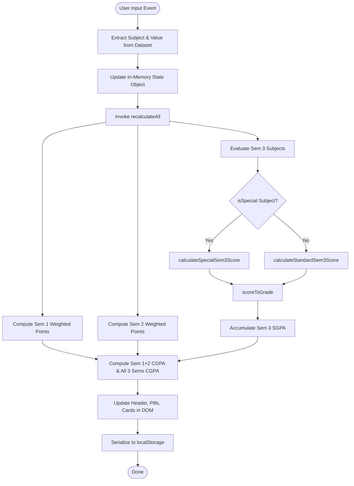

# Low-Level Design (LLD)

**System Name:** SGPA & CGPA Academic Calculator  
**Document Version:** 1.0.0  
**Implementation Language:** JavaScript (ES6+), HTML5, CSS3  

---

## 1. Data Structures & Constants

### 1.1 `GRADE_SCALE` Array
Defines the mapping between percentage score brackets, letter grades, and grade points:

```javascript
const GRADE_SCALE = [
  { grade: 'O',   points: 10, min: 91, max: 100 },
  { grade: 'A+',  points: 9,  min: 81, max: 90 },
  { grade: 'A',   points: 8,  min: 71, max: 80 },
  { grade: 'B+',  points: 7,  min: 61, max: 70 },
  { grade: 'B',   points: 6,  min: 51, max: 60 },
  { grade: 'C',   points: 5,  min: 41, max: 50 },
  { grade: 'D',   points: 4,  min: 31, max: 40 },
  { grade: 'E/F', points: 0,  min: 0,  max: 30 },
];
```

### 1.2 `GRADE_POINTS_MAP` Lookup
Provides $O(1)$ letter-grade-to-points translation:

```javascript
const GRADE_POINTS_MAP = {
  'O': 10, 'A+': 9, 'A': 8, 'B+': 7,
  'B': 6,  'C': 5,  'D': 4, 'E/F': 0
};
```

### 1.3 `SEMESTER_DATA` Curriculum Metadata
Static specification of semesters, credits, subject IDs, names, and special flags:

```javascript
const SEMESTER_DATA = {
  sem1: {
    name: 'Semester 1',
    totalCredits: 26,
    subjects: [
      { id: 'sem1_sub1', name: 'Breadth of Computer Science 1', credits: 4 },
      { id: 'sem1_sub2', name: 'Front-End Web Development', credits: 4 },
      { id: 'sem1_sub3', name: 'Problem Solving Using Programming', credits: 4 },
      { id: 'sem1_sub4', name: 'Critical Thinking 101', credits: 4 },
      { id: 'sem1_sub5', name: 'Design for Developers', credits: 3 },
      { id: 'sem1_sub6', name: 'Discrete Mathematics and Probability', credits: 4 },
      { id: 'sem1_sub7', name: 'Professional Skills for the Workplace', credits: 3 },
    ]
  },
  sem2: {
    name: 'Semester 2',
    totalCredits: 20,
    subjects: [
      { id: 'sem2_sub1', name: 'Breadth of Computer Science 2', credits: 4 },
      { id: 'sem2_sub2', name: 'Back-End Web Development', credits: 5 },
      { id: 'sem2_sub3', name: 'Databases', credits: 3 },
      { id: 'sem2_sub4', name: 'Full Stack Development', credits: 4 },
      { id: 'sem2_sub5', name: 'Learning How to Learn', credits: 4 },
    ]
  },
  sem3: {
    name: 'Semester 3',
    totalCredits: 22,
    subjects: [
      { id: 'sem3_sub1', name: 'Object Oriented Programming', credits: 3, isSpecial: false },
      { id: 'sem3_sub2', name: 'Object Oriented Programming Laboratory', credits: 1, isSpecial: false },
      { id: 'sem3_sub3', name: 'Database Management Systems', credits: 3, isSpecial: false },
      { id: 'sem3_sub4', name: 'Economics, Politics and Rural Society Development', credits: 3, isSpecial: false },
      { id: 'sem3_sub5', name: 'Integrated Work with a Partner Company-I', credits: 8, isSpecial: true },
      { id: 'sem3_sub6', name: 'Mathematical Thinking 101', credits: 4, isSpecial: false },
    ]
  }
};
```

### 1.4 Runtime State Schema (`state`)
```javascript
const state = {
  activeTab: 'sem3', // 'sem1' | 'sem2' | 'sem3'
  sem1: {
    // [subjectName: string]: 'O' | 'A+' | 'A' | 'B+' | 'B' | 'C' | 'D' | 'E/F' | ''
  },
  sem2: {
    // [subjectName: string]: 'O' | 'A+' | 'A' | 'B+' | 'B' | 'C' | 'D' | 'E/F' | ''
  },
  sem3: {
    // Standard subject: { ca1?: string, ca2?: string, ca3?: string, ca4?: string, ca5?: string, att?: string }
    // Special subject:  { slots_present?: string, slots_counted?: string, days_present?: string, days_counted?: string, viva1?: string, viva2?: string, viva3?: string, uni_viva?: string }
  }
};
```

---

## 2. Core Functions & Algorithmic Design



---

### 2.1 `getAttendanceMarks(attPercent)`
- **Input:** `attPercent: number | string | null`
- **Output:** `number` (0, 2, 3, 4, or 5)
- **Logic:**
  ```javascript
  function getAttendanceMarks(attPercent) {
    if (attPercent === null || attPercent === undefined || attPercent === '' || isNaN(parseFloat(attPercent))) return 0;
    const att = parseFloat(attPercent);
    if (att >= 90) return 5;
    if (att >= 85) return 4;
    if (att >= 80) return 3;
    if (att >= 75) return 2;
    return 0;
  }
  ```

---

### 2.2 `scoreToGrade(score)`
- **Input:** `score: number | null`
- **Output:** `{ grade: string, points: number, score: number } | null`
- **Algorithm:**
  1. If `score` is `null`, `undefined`, or `NaN`, return `null`.
  2. Round score to nearest integer: `rounded = Math.round(score)`.
  3. Traverse `GRADE_SCALE` to find match where `rounded >= tier.min && rounded <= tier.max`.
  4. Upper clamp check: if `rounded > 100`, return `{ grade: 'O', points: 10, score: 100 }`.
  5. Default fallback: return `{ grade: 'E/F', points: 0, score: Math.max(0, rounded) }`.

---

### 2.3 `calculateStandardSem3Score(ca1, ca2, ca3, ca4, ca5, attPercent)`
- **Input:** 6 numeric/string parameters for CA1–CA5 marks and attendance percentage.
- **Output:** `{ score: number, isComplete: boolean } | null`
- **Logic:**
  - If all parameters are empty/unprovided, return `null`.
  - Missing parameters default to 0.
  - Limits enforced: $CA_1, CA_2, CA_3 \in [0, 40]$, $CA_4, CA_5 \in [0, 60]$, Attendance $\in [0, 100]$.
  - Strict calculation for given marks (no optimistic/future projected output):
    $$\text{part1} = \left(\frac{90}{5 \times 40}\right) \times (c_1 + c_2 + c_3) = 0.45 \times (c_1 + c_2 + c_3)$$
    $$\text{part2} = \left(\frac{90}{5 \times 60}\right) \times (c_4 + c_5) = 0.30 \times (c_4 + c_5)$$
    $$\text{totalScore} = \min(100, \max(0, \text{Round}(\text{part1} + \text{part2} + \text{attMarks})))$$

---

### 2.4 `calculateSpecialSem3Score(slotsPresent, slotsCounted, daysPresent, daysCounted, viva1, viva2, viva3, uniViva)`
- **Input:** 8 numeric/string parameters for Partner Company continuous evaluation and university faculty viva.
- **Output:** `{ score, kalvium100, kalvium70, uniVivaScore, attendanceScore, worklogScore, vivaScore, isComplete } | null`
- **Logic:**
  - If all parameters are empty/unprovided, return `null`.
  - Missing parameters default to 0; no future projections:
    $$\text{attendanceScore} = \left(\frac{\text{slotsPresent}}{\text{slotsCounted}}\right) \times 25 \quad (\text{if } \text{slotsCounted} > 0)$$
    $$\text{worklogScore} = \left(\frac{\text{daysPresent}}{\text{daysCounted}}\right) \times 25 \quad (\text{if } \text{daysCounted} > 0)$$
    $$\text{vivaScore} = \left(\frac{v_1 + v_2 + v_3}{3}\right) \times \left(\frac{50}{25}\right) \quad (v_i \in [0, 25])$$
    $$\text{kalvium}_{100} = \text{attendanceScore} + \text{worklogScore} + \text{vivaScore}$$
    $$\text{kalvium}_{70} = \text{kalvium}_{100} \times 0.70$$
    $$\text{totalScore} = \min(100, \max(0, \text{Round}(\text{kalvium}_{70} + \text{uniVivaScore}))) \quad (\text{uniVivaScore} \in [0, 30])$$

---

### 2.5 `recalculateAll()`
- **Purpose:** Central aggregator that computes all semester SGPAs, overall CGPAs, updates UI elements, and triggers localStorage persistence.
- **Workflow:**
  1. **Sem 1:** Sums $(\text{credits} \times \text{points})$ for entered dropdowns. Divides by entered credits $\rightarrow \text{sem1Sgpa}$.
  2. **Sem 2:** Sums $(\text{credits} \times \text{points})$ for entered dropdowns. Divides by entered credits $\rightarrow \text{sem2Sgpa}$.
  3. **Sem 3:** Evaluates standard/special subjects via calculation engines. If grade is resolved, adds $(\text{credits} \times \text{points})$. Divides by entered credits $\rightarrow \text{sem3Sgpa}$.
  4. **Sem 1 & 2 CGPA:**
     $$\text{CGPA}_{1,2} = \frac{\text{sem1Weighted} + \text{sem2Weighted}}{\text{sem1Credits} + \text{sem2Credits}}$$
  5. **All 3 Sems CGPA:**
     $$\text{CGPA}_{\text{All}} = \frac{\text{sem1Weighted} + \text{sem2Weighted} + \text{sem3Weighted}}{\text{sem1Credits} + \text{sem2Credits} + \text{sem3Credits}}$$
  6. Updates DOM elements: `#cgpaDisplay`, `#cgpaAllSemsDisplay`, `#sem1TabSgpa`, `#sem2TabSgpa`, `#sem3TabSgpa`, `#currentSemSgpaDisplay`.
  7. Invokes `saveToLocalStorage()`.

---

## 3. DOM Element Mappings & IDs

| DOM Selector / ID | Purpose |
| :--- | :--- |
| `#cgpaDisplay` | Header display for Sem 1 & 2 CGPA |
| `#cgpaAllSemsDisplay` | Header sub-badge for All 3 Semesters CGPA |
| `#tabSem1`, `#tabSem2`, `#tabSem3` | Tab navigation buttons |
| `#sem1TabSgpa`, `#sem2TabSgpa`, `#sem3TabSgpa` | Dynamic SGPA indicator pills on tabs |
| `#panelSem1`, `#panelSem2`, `#panelSem3` | Container panels for semester subject cards |
| `#sem1SubjectsGrid`, `#sem2SubjectsGrid` | Subject grid for dropdowns |
| `#sem3SubjectsContainer` | Subject grid for continuous assessment inputs |
| `#currentSemLabel`, `#currentSemSgpaDisplay` | Top-right summary card for the currently active tab |
| `#guidelinesModal` | Full-screen accessible modal dialog for worklog & journal form guidelines |
| `#closeModalBtn`, `#modalGotItBtn` | Buttons to dismiss guidelines modal |
| `#copyFilterBtn` | One-click clipboard copy button for email search filter query |
| `.btn-open-guidelines` | Small `(i)` icon buttons in the subject header and input labels to open the full guidelines dialog |

---

## 4. LocalStorage Key Specification

| Storage Key | Format | Example Stored Value |
| :--- | :--- | :--- |
| `sgpa_sem1` | JSON Object | `{"Breadth of Computer Science 1": "A+", "Front-End Web Development": "O"}` |
| `sgpa_sem2` | JSON Object | `{"Back-End Web Development": "A", "Databases": "B+"}` |
| `sgpa_sem3` | JSON Object | `{"Object Oriented Programming": {"ca1": "35", "ca2": "38", "att": "92"}}` |
| `sgpa_active_tab` | String | `"sem3"` |

---

## 5. Error Handling & Edge Case Matrix

| Scenario | Input Condition | Expected Behavior |
| :--- | :--- | :--- |
| **Empty Subject Input** | All fields `""` or whitespace | Treats subject as unentered (`null`); displays `-` and does not add credits to SGPA. |
| **Partial Subject Input** | 1 or more fields entered | Evaluates strictly for entered marks; unentered CAs/vivas default to 0 (no future projections). |
| **Non-numeric Input** | Characters e.g. `"abc"` | `parseFloat()` returns `NaN`, input is ignored gracefully. |
| **Out-of-bound CA Values** | Marks $> 40$ (CA1-3) or $> 60$ (CA4-5) | Clamped strictly to respective limits `[0, 40]` and `[0, 60]`. |
| **Out-of-bound Viva Values** | Marks $> 25$ (Kalvium Viva) or $> 30$ (Uni Viva) | Clamped strictly to `[0, 25]` and `[0, 30]`. |
| **Zero Credits Entered** | No subjects selected/filled | Displays `0.00` / `-` without triggering divide-by-zero errors. |
| **Quota Exceeded in Storage** | Private Browsing / Full Storage | `try-catch` block catches storage error and logs warning without breaking UI. |
